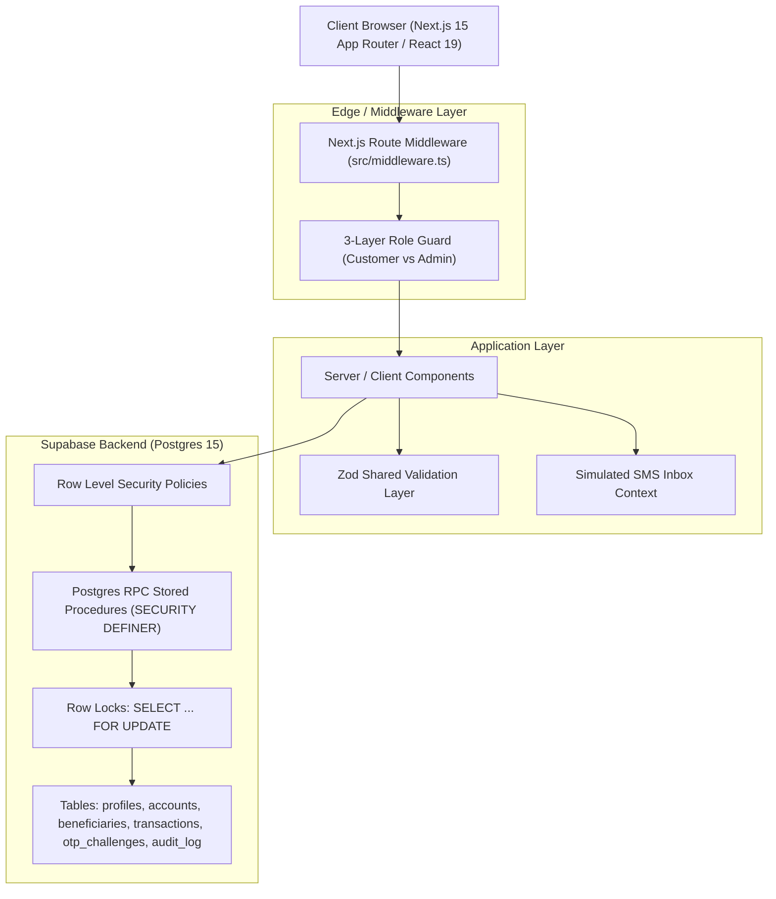
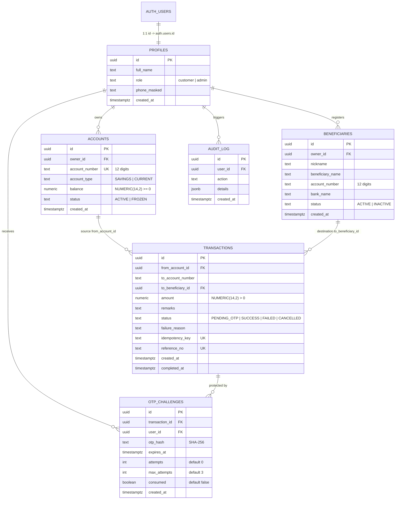

# Technical Architecture & Engineering Decisions

**Project**: Apex Trust Bank – Scaling Agile Prototype  
**Audience**: Technical Jury & System Architects

---

## 1. System Architecture Overview



---

## 2. Technology Choices & Justification

| Technology | Selection Rationale | Alternatives Evaluated |
|:---|:---|:---|
| **Next.js 15 (App Router)** | Full-stack server and client integration, SSR cookie auth, unified routing, fast dev server, and native API handlers. | Vite + Express (rejected: higher operational complexity for full-stack demo). |
| **Supabase Postgres** | Native Row Level Security (RLS), ACID-compliant relational storage, built-in Auth (JWT), and trigger-based provisioning. | Mock In-Memory DB (rejected: required real database prototype per prompt). |
| **Postgres RPC (`SECURITY DEFINER`)** | Enforces transactional consistency and atomic balance adjustments (`SELECT ... FOR UPDATE`), preventing double-spends and client race conditions. | ORM-level balance increment/decrement (rejected: prone to dirty reads and race conditions). |
| **Zod** | Shared, type-safe schema validation across client forms and server functions with runtime boundary guarantees. | Yup / Joi (rejected: inferior TypeScript inference). |
| **Simulated SMS Inbox Drawer** | Guarantees complete offline functionality during university jury demonstrations without SMS telecom latency, OTP delivery costs, or failure risks. | Twilio / MSG91 (rejected: external network dependency, cost, potential jury connectivity blocks). |
| **Vitest & Playwright** | Fast unit testing for Zod schemas (Vitest) combined with real browser automation (Playwright) for end-to-end verification. | Jest + Cypress (rejected: Vitest shares Next.js/Vite speed; Playwright is more reliable in CI). |

---

## 3. Entity-Relationship Diagram (ERD)



---

## 4. Atomic Transfer Sequence Diagram (with Row Locks & OTP)

```mermaid
sequenceDiagram
    autonumber
    actor Customer
    participant UI as Next.js Transfer UI
    participant SMS as Simulated SMS Inbox
    participant PG as Postgres (initiate_transfer)
    participant PG2 as Postgres (confirm_transfer)
    participant DB as Postgres Tables

    Customer->>UI: Selects from_account, beneficiary, amount, enters remarks
    UI->>UI: Validate Zod constraints (min ₹1, max ₹100k, 2 decimals)
    UI->>PG: initiate_transfer(from, to, amount, idempotency_key)
    
    activate PG
    PG->>DB: Check idempotency_key
    PG->>DB: Check 60-second duplicate submission window
    PG->>DB: Check caller ownership & account status (ACTIVE vs FROZEN)
    PG->>DB: Check sufficient balance & 24h daily limit (₹2,00,000.00)
    PG->>DB: INSERT into transactions (status: 'PENDING_OTP')
    PG->>DB: Generate 6-digit OTP, store SHA-256 hash in otp_challenges
    PG-->>UI: Returns { success, txn_id, ref_no, simulated_otp, expires_at }
    deactivate PG

    UI->>SMS: addSimulatedSms({ sender: "VK-APEXBANK", otp: simulated_otp, amount })
    SMS-->>Customer: Notification & Simulated SMS displays code on screen

    Customer->>UI: Submits 6-digit OTP
    UI->>PG2: confirm_transfer(transaction_id, otp)

    activate PG2
    PG2->>DB: Fetch otp_challenges; verify consumed=false & now() < expires_at
    PG2->>DB: Compare SHA-256 hash(otp). If mismatch: increment attempts (fail if >= 3)
    PG2->>DB: SELECT * FROM accounts WHERE id = from_account FOR UPDATE (ROW LOCK)
    PG2->>DB: SELECT * FROM accounts WHERE account_number = to FOR UPDATE (ROW LOCK)
    PG2->>DB: Verify balance >= amount & both accounts ACTIVE
    PG2->>DB: UPDATE accounts SET balance = balance - amount WHERE id = from_account
    PG2->>DB: UPDATE accounts SET balance = balance + amount WHERE account_number = to
    PG2->>DB: UPDATE transactions SET status = 'SUCCESS', completed_at = now()
    PG2->>DB: UPDATE otp_challenges SET consumed = true
    PG2->>DB: INSERT INTO audit_log (action: 'TRANSFER_SUCCESS')
    PG2-->>UI: Returns { success: true, ref_no, status: 'SUCCESS' }
    deactivate PG2

    UI->>UI: Trigger confetti animation & display Success Receipt
    Customer->>UI: Views Receipt and updated account balance
```
